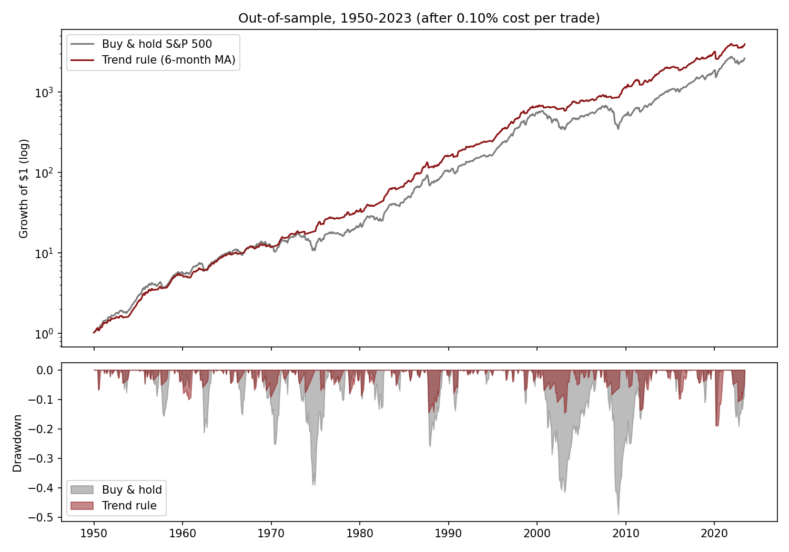
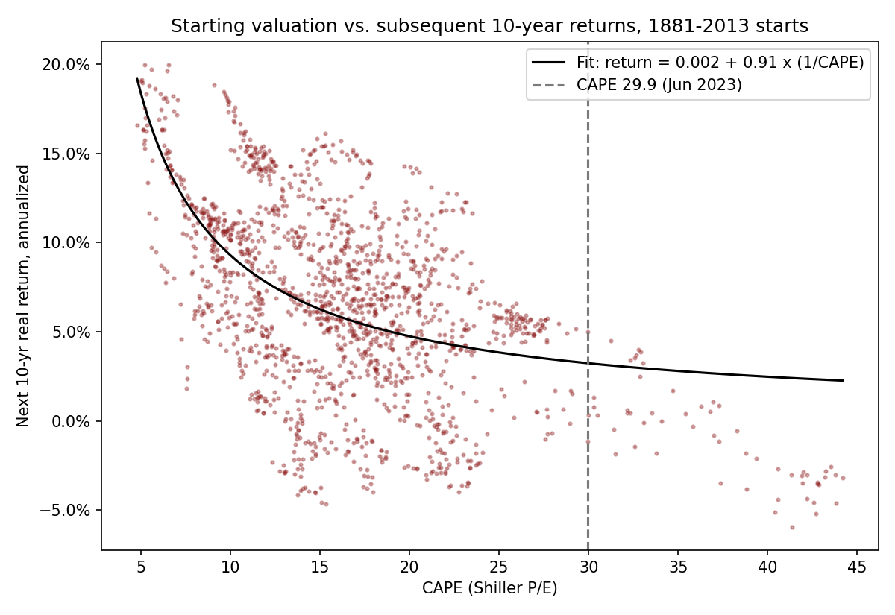

# S&P 500 Trend-Following Backtest and CAPE Valuation Study (1881–2023)

A Python study of two classic investing questions, tested on 140+ years of monthly S&P 500 data with an honest in-sample / out-of-sample split.

1. **Trend following:** Does owning stocks only when the S&P 500 is above its moving average (and bonds otherwise) beat buy-and-hold after trading costs?
2. **Valuation:** Does the starting CAPE ratio (price / 10-year average real earnings) predict the next 10 years of real returns, and does that hold up out of sample?

## How to run

```bash
pip install -r requirements.txt
python backtest.py
```

The script downloads the data on first run, prints the results, and writes tables (CSV) and charts (PNG) to `results/`.

## Data

Robert Shiller's monthly S&P 500 dataset (price, dividends, earnings, CPI, 10-year Treasury yield, CAPE), as mirrored at [github.com/datasets/s-and-p-500](https://github.com/datasets/s-and-p-500). All columns are complete from 1881 through June 2023, so the study uses that window.

## Method

**Part 1: Trend rule**
- Signal: at each month-end, if the S&P 500 is above its N-month simple moving average, hold stocks next month; otherwise hold bonds. The signal is lagged one month so the backtest never uses information it would not have had (no look-ahead bias).
- Stock return = price change + 1/12 of the annual dividend. Bond return = 1/12 of the 10-year Treasury yield.
- Cost: 0.10% every time the strategy switches between stocks and bonds.
- **Parameter choice in-sample only:** N is chosen from 6–12 months by the best Sharpe ratio on 1881–1949. That single choice is then judged on 1950–2023, a period the selection never saw.
- Significance: t-statistic on the monthly return difference (trend minus buy-and-hold), out of sample.

**Part 2: CAPE regression**
- Target: annualized real total return over the following 10 years.
- Model: OLS of that return on the CAPE earnings yield (1/CAPE).
- **Out-of-sample test:** for every month from 1950 on, the model is refit using only observations whose 10-year outcome was already known at that date, then used to forecast. Forecast errors are compared against the naive forecast (the historical average return) using out-of-sample R².

## Results

**Part 1: chosen lookback = 6 months**

| Period | Strategy | CAGR | Volatility | Sharpe | Max drawdown |
|---|---|---|---|---|---|
| 1881–1949 (in-sample) | Buy & hold | 6.8% | 16.3% | 0.28 | −81.8% |
| | Trend (6-mo) | 10.1% | 10.1% | 0.67 | −25.5% |
| **1950–2023 (out-of-sample)** | Buy & hold | 11.3% | 12.1% | 0.50 | −49.0% |
| | **Trend (6-mo)** | **11.9%** | **8.9%** | **0.70** | **−19.0%** |

Out of sample, the trend rule was invested in stocks 69% of the time and traded about 2 times a year. The return difference was **not statistically significant (t = 0.22)**. Its value showed up as lower risk: similar returns with roughly a quarter less volatility and less than half the worst drawdown.

| Crash | Buy & hold | Trend (6-mo) |
|---|---|---|
| 1929–32 | −81.0% | −16.8% |
| 1973–74 | −38.4% | −0.9% |
| 2000–02 | −39.3% | −7.8% |
| 2007–09 | −44.3% | −2.6% |

**Part 2: CAPE vs. next-10-year real return**
- Full-sample fit: return ≈ 0.002 + 0.91 × (1/CAPE), R² = 0.28.
- **Out-of-sample R² vs. the historical mean (1950+): 0.20** across 762 monthly forecasts, so valuation added real forecasting power over simply assuming the average return.
- At the last data point (June 2023), CAPE was 29.9, which implies about **3.2% a year** in real returns over the following decade.




## Takeaways

- A simple trend rule did not reliably beat the market on return, but it substantially improved risk-adjusted performance and avoided most of the damage in major bear markets, including out of sample.
- Starting valuation matters for long-horizon returns. High CAPE readings have been followed by lower decade returns, and the relationship survives an out-of-sample test. It says little about the next year, though, so it is a poor short-term timing tool.

## Limitations (what I would tell an interviewer)

- **Monthly average prices:** Shiller's monthly prices are averages of daily closes, not month-end prices. Averaging smooths the series and tends to flatter trend rules, so real-world results with month-end prices would likely be somewhat weaker.
- **Bond leg is yield only:** the safe asset earns the 10-year yield but ignores bond price changes. That overstates bond returns when rates rose (1950–1981) and understates them when rates fell.
- **No taxes**, and a flat 0.10% trading cost. Switching in a taxable account would create taxable gains.
- **One market, one asset:** US stocks had an unusually strong century. The results may not carry over to other countries or asset classes.
- **Overlapping 10-year windows** in Part 2 make the full-sample R² look more precise than it is. The out-of-sample R² is the more honest number.
- **Data snooping:** trend following and CAPE are both well-known ideas, chosen partly because they worked historically. The out-of-sample split helps but doesn't remove that bias.

## Possible extensions

- Rerun with month-end prices and a total-return bond index (for example, from FRED) to fix the two biggest limitations.
- Test the trend rule across sectors or countries.
- Combine signals: use CAPE to size the stock allocation and the trend rule to cut risk.
